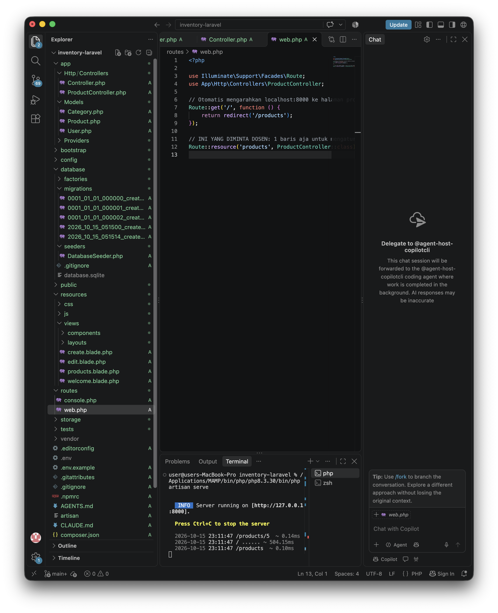
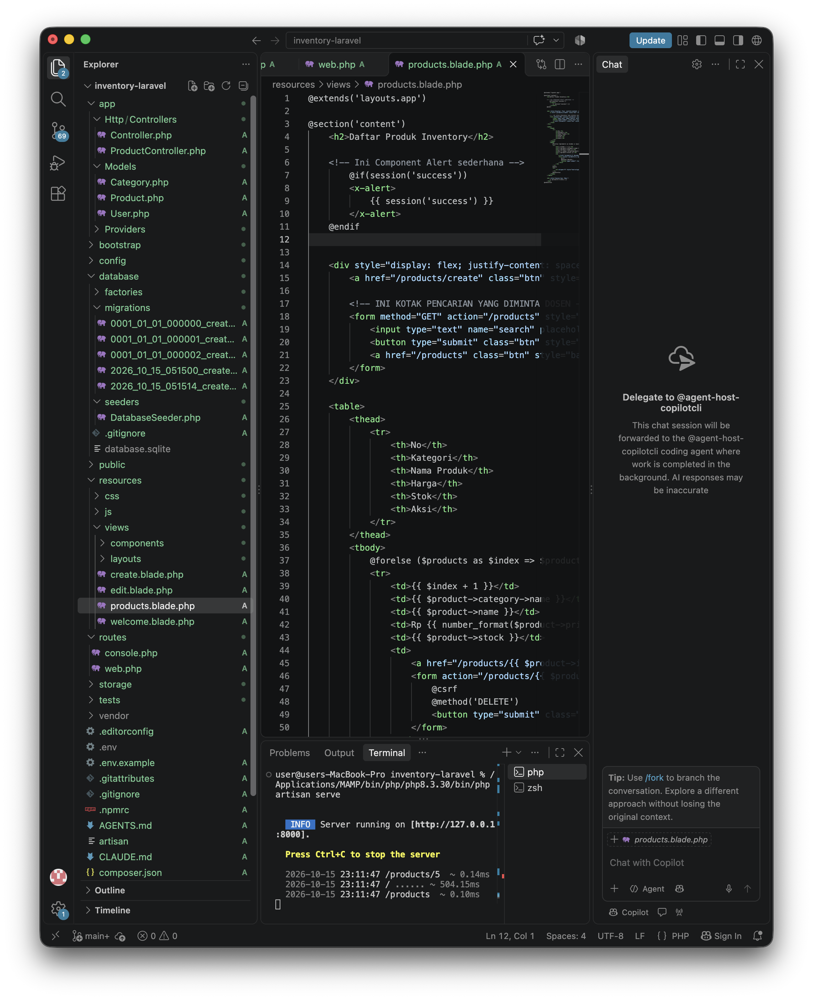
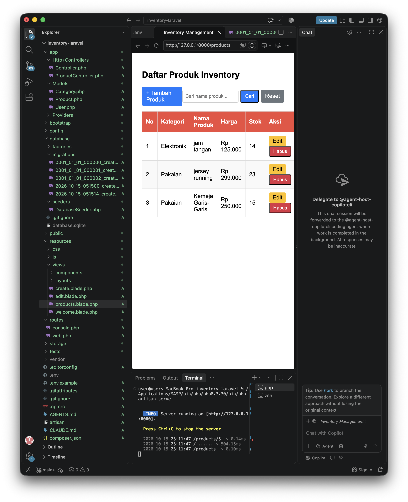
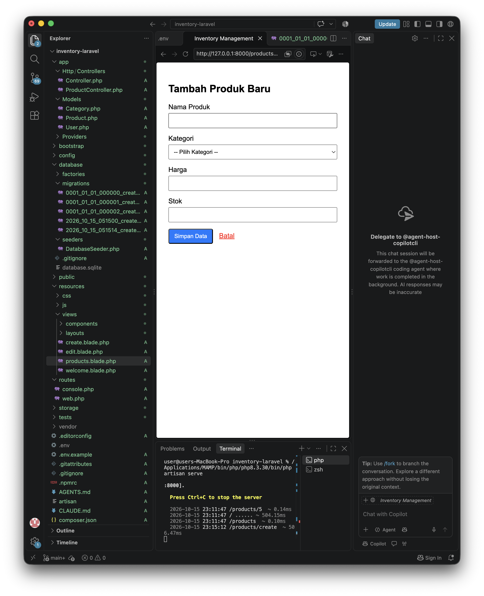

# Inventory Management System - Laravel

Ini adalah migrasi tugas Mini Project 4 (PHP Native) ke dalam framework Laravel (Mini Project 5).

## Cara Instalasi & Menjalankan Project
1. Clone repository ini.
2. Buka terminal di folder project, jalankan `composer install`.
3. Copy file `.env.example` menjadi `.env`.
4. Sesuaikan konfigurasi database di `.env` (Contoh: `DB_PORT=8889` untuk MAMP).
5. Generate key dengan menjalankan `php artisan key:generate`.
6. Jalankan migrasi dan seeder: `php artisan migrate:fresh --seed`.
7. Jalankan server lokal: `php artisan serve`.
8. Buka browser di `http://127.0.0.1:8000`.

## Penjelasan Singkat Arsitektur MVC
Project ini menggunakan arsitektur MVC (Model-View-Controller) dengan alur:
- **Route:** Menerima *request* dari user (misal: `/products`) dan meneruskannya ke Controller.
- **Controller (`ProductController.php`):** Bertugas mengatur *business logic*, seperti validasi form, mengambil request search/pagination, lalu meminta data ke Model.
- **Model (`Product.php` & `Category.php`):** Merepresentasikan tabel di database. Mengatur relasi Eloquent (`belongsTo` & `hasMany`) serta keamanan data (`$fillable`).
- **View (`Blade`):** Menampilkan data yang dikirim Controller ke user. Memisahkan kerangka utama (`app.blade.php`), komponen berulang (`alert.blade.php`), dan halaman spesifik (`products.blade.php`).

## Screenshot Aplikasi

### 1. Route (Resource)

### 2. Blade View & Component

### 3. Halaman CRUD (Daftar Produk & Pencarian)

### 4. Form Tambah/Edit Produk dengan Validasi

